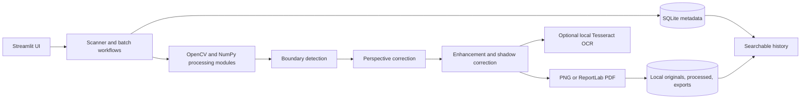
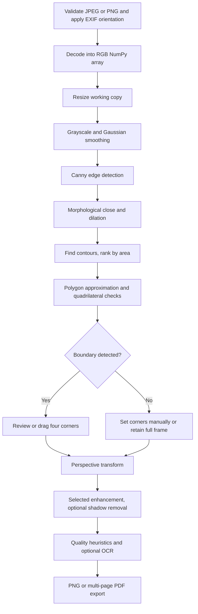

# Scanify — Smart Document Scanner

**Turn Every Document Into a Perfect Scan.** Scanify is a local-first BTech image-processing application that turns document photographs into perspective-corrected, enhanced scans. Its core is traditional computer vision implemented with OpenCV and NumPy; OCR is an optional additional feature.

## Problem statement and objectives

Camera photos often contain perspective distortion, uneven illumination, noise and low contrast. Scanify demonstrates how classical digital image-processing operations can improve readability and produce shareable files without sending documents to a cloud service. The objectives are to implement a reproducible scanning pipeline, expose its processing parameters, provide optional local OCR, and retain searchable local document history.

## Features

- JPEG/PNG validation, 20 MB limit, dimensions and pixel-count checks, and EXIF orientation correction.
- Canny edge detection, morphology, contour area ranking and polygon approximation for document boundary detection.
- Interactive draggable four-corner selection when automatic detection needs correction.
- Perspective transform, seven enhancement modes, brightness/contrast/sharpness/denoising controls, optional shadow correction and heuristic quality analysis.
- Batch processing with per-image error isolation, page removal/reordering, individual PNG and combined multipage PDF downloads.
- Tesseract OCR when installed; editable OCR text with TXT download and searchable history.
- Local SQLite history metadata with image/PDF files stored separately; search, preview, download and confirmed deletion.
- Single/multiple page PDFs made with ReportLab while preserving page aspect ratio.

## Technology stack

Python 3.11+ · Streamlit · OpenCV · NumPy · Pillow · Pytesseract · Tesseract OCR · ReportLab · SQLite · Pytest.

## Architecture



### Image-processing workflow



## Algorithm notes

Images are decoded into 8-bit RGB arrays where each pixel stores three channel intensities. Grayscale conversion creates a single intensity plane for operations such as edge detection and adaptive thresholding. Gaussian smoothing attenuates high-frequency noise before Canny computes intensity gradients and hysteresis edges. Morphological closing joins nearby edge fragments while dilation makes contours easier to trace. Contours are ranked by area, simplified by `approxPolyDP`, and filtered for a plausible four-corner geometry. If the detector is uncertain it returns no result rather than claiming a false boundary.

The manual corner component displays numbered draggable handles and sends normalized point positions back to Streamlit. The points are validated as a convex, non-degenerate quadrilateral. `getPerspectiveTransform` computes a projective mapping and `warpPerspective` rectifies the document. Adaptive Gaussian thresholding chooses a local threshold for each region, making it more suitable than a single global threshold under uneven lighting. CLAHE enhances local contrast. Denoising, median filtering, bilateral filtering and unsharp masking are available as classical operations. Shadow correction estimates a slowly varying background by morphological closing and normalizes channel illumination.

Quality values (brightness, contrast, variance of Laplacian blur score and a simple high-frequency noise estimate) are heuristics, not certified image-quality measurements. OCR is not guaranteed to be accurate; results depend on focus, layout, language packs and Tesseract configuration.

## Project structure

```text
app.py
config.py
requirements.txt
README.md
modules/                 # Image processing, OCR, PDF and SQLite
components/              # Streamlit sections and draggable-corner component
components/corner_editor/frontend/index.html
assets/                  # Optional visual assets
storage/originals/       # Uploaded originals (created automatically)
storage/processed/       # Processed images
storage/exports/         # Batch PDF exports
.streamlit/config.toml
tests/                   # Synthetic-image pytest coverage
```

## Installation (Windows PowerShell)

1. Install Python 3.11 or newer and create/activate a virtual environment in the project directory.
2. Install Python dependencies:

   ```powershell
   python -m pip install -r requirements.txt
   ```

3. Install Tesseract OCR separately for OCR support. Install the English language data (`eng`) and optionally Hindi (`hin`), then make sure `tesseract.exe` is on `PATH`. Restart the terminal after changing PATH. Without Tesseract, all scanning, enhancement and PDF functions remain usable; OCR shows an installation notice.
4. Start the app:

   ```powershell
   streamlit run app.py
   ```

The app creates the local SQLite database and storage directories at first launch. Do not expose the Streamlit server to untrusted networks without authentication and access controls.

## Deploy from GitHub with Streamlit Community Cloud

Git stores and versions the source code; it does not host the running web app by itself. To publish Scanify, push this repository to GitHub, then create a Streamlit Community Cloud app using the repository, the branch you pushed, and `app.py` as the entry point. Community Cloud installs dependencies from `requirements.txt`.

The app's scan history and uploaded/processed files are local filesystem data. Hosted instances may restart or replace their local storage, so this deployment is suitable for a demo, not durable document storage. Do not upload sensitive documents to a public demo. Tesseract OCR also requires the system executable and language data; the Python package alone does not install it. OCR remains optional if Tesseract is unavailable. For persistent or private production use, deploy to a controlled host with durable encrypted storage and access control.

## Tests

```powershell
python -m pytest -q
```

Tests use generated images and temporary SQLite databases; they do not depend on camera photos or a Tesseract installation. `pypdf` is used by the PDF test to verify page counts.

## Limitations

- Contour detection can fail on low-contrast backgrounds, clipped pages, strong shadows or visually busy scenes; the draggable manual editor is provided for correction.
- The application supports JPEG and PNG input only. Very large uploads are rejected to protect local memory.
- OCR language availability is determined by the local Tesseract installation. OCR is an aid, not a guarantee of exact transcription.
- Settings are session defaults rather than a user-management system. History and scan files are local and unencrypted.
- This project is intended for local use. It does not provide authentication, multi-user isolation, encrypted storage or hardened public deployment.
- Responsive styling uses Streamlit's layout behavior and adapts to narrow viewports; this is not a separately compiled native mobile UI.

## Future enhancements

Potential next steps include encrypted-at-rest storage, PDF text layers, OCR confidence visualization, deskew and page orientation estimation, document profiles, stronger illumination models and a full UI-level integration test suite.
